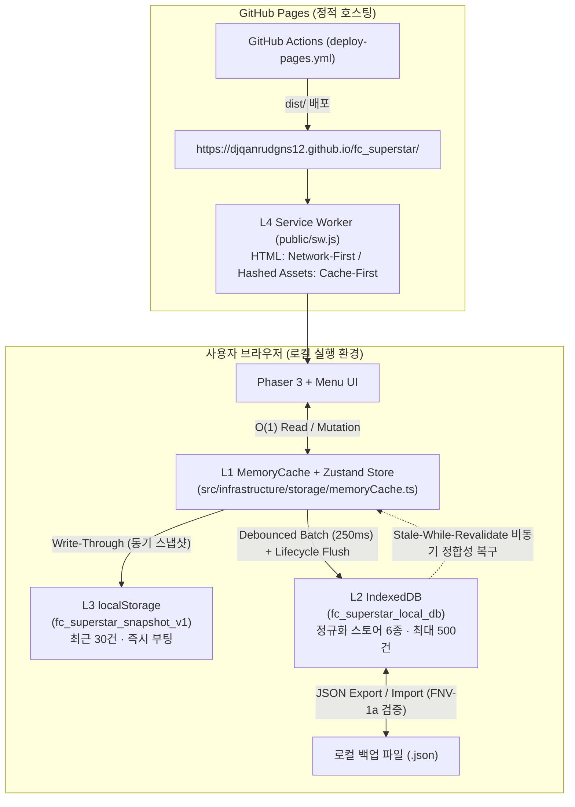

# FC SUPERSTAR — GitHub Pages 호스팅 & 로컬 DB/캐싱 운영 원칙

## 1. 전체 아키텍처 개요

FC SUPERSTAR는 **백엔드 서버 없는(Zero-Backend) 정적 웹 애플리케이션**으로, GitHub Pages를 통해 정적 에셋을 호스팅하고 모든 게임 데이터는 사용자의 브라우저 로컬 데이터베이스에서 관리합니다.

---

## 2. 4계층 캐싱 & 로컬 DB 구조

| 계층 | 기술 / 위치 | 역할 | 보존/갱신 정책 |
| :--- | :--- | :--- | :--- |
| **L1 (Hot Cache)** | `MemoryCache` + Zustand (`src/infrastructure/storage/memoryCache.ts`) | 60fps 경기/UI 렌더링 중 O(1) 조회 (`getPlayer`, `getOwnedPlayers`, `getTeamOverall`) | LRU 최대 160개 엔트리, 상태 변경 시 버전 증가로 원자적 무효화(`invalidateAll`) |
| **L2 (Primary Local DB)** | IndexedDB (`fc_superstar_local_db`, `indexedDbAdapter.ts`) | 대용량·구조화 로컬 영구 데이터베이스 (`meta`, `team`, `players`, `shop`, `matches`, `trainings`) | 250ms 디바운스 배치 트랜잭션 + 탭 종료/숨김 시 즉시 flush, 경기/훈련 최대 500건 보존 |
| **L3 (Fast-Boot Snapshot)** | `localStorage` (`fc_superstar_snapshot_v1`, `localDbManager.ts`) | 초기 화면 동기 즉시 부팅(0ms 대기) 및 IndexedDB 미지원 환경 폴백 | 최근 경기 30건 / 훈련 30건으로 상한 제한(5MB 쿼터 보호), 용량 부족 시 5건 컴팩트 폴백 |
| **L4 (Static Asset Cache)** | Service Worker (`public/sw.js`) + Vite 청크 분할 (`phaser`, `vendor`) | GitHub Pages 정적 번들 네트워크 트래픽 절감 및 오프라인 대응 | HTML: Network-First / 해시 번들(`/assets/*`): Cache-First / 폰트 CDN: Stale-While-Revalidate |

---

## 3. 데이터베이스 로컬 저장 7대 원칙

### 원칙 1. 로컬 우선·무서버 주권 (Local-First & Zero-Server Sovereignty)
- 모든 구단 정보, 보유 선수, 훈련 스탯, 코인, 경기/훈련 이력은 사용자의 로컬 브라우저에만 저장됩니다.
- 외부 API 서버나 원격 데이터베이스로 개인 플레이 데이터를 전송하지 않으며, GitHub Pages는 순수 정적 파일 서빙 역할만 수행합니다.

### 원칙 2. 쓰기 일관성 및 부하 절감 (Write-Through + Debounced Batch + Lifecycle Flush)
- 상태 변경(영입, 포메이션 변경, 경기 보상, 훈련 완료) 발생 시:
  1. **L1** 메모리 캐시 즉시 무효화 및 Zustand 상태 반영
  2. **L3** `localStorage` 스냅샷 동기 기록(즉각 내구성 확보)
  3. **L2** `IndexedDB` 비동기 트랜잭션을 250ms 디바운스로 병합 기록
- `visibilitychange (hidden)`, `pagehide`, `beforeunload` 이벤트 발생 시 대기 중인 L2 쓰기 큐를 즉시 flush하여 탭 종료 직전의 데이터 유실을 방지합니다.

### 원칙 3. 스키마 버전 관리 및 무손실 자동 마이그레이션 (Schema Versioning & Idempotent Migration)
- 모든 저장 데이터는 `StorageEnvelope` (`namespace`, `schemaVersion`, `updatedAt`, `checksum`, `payload`) 포맷으로 감싸 관리합니다.
- 기존 `soccer_manager_save` 레거시 키가 감지되면 최초 실행 시 자동으로 `v1` 포맷(L2 + L3)으로 무손실 마이그레이션합니다.
- 향후 신규 선수·마스터 데이터가 추가 배포되더라도 기존 유저의 훈련 스탯·보유 로스터·코인을 덮어쓰지 않고 신규 항목만 안전하게 병합합니다.

### 원칙 4. 무결성 검증 및 손상 격리·자가 복구 (Integrity Validation & Self-Healing)
- 저장 시 엔티티 순서에 무관한 **정규화 FNV-1a 체크섬**을 생성하여 함께 기록합니다.
- 읽기 시 체크섬 불일치 또는 구조 손상이 감지되면:
  - L3가 손상된 경우 손상 원본을 `fc_superstar_corrupted_backup`에 격리한 뒤 **L2 IndexedDB에서 자동 복구**합니다.
  - L2가 비어 있거나 오래된 경우 L3 스냅샷으로 L2를 자동 시딩(Seeding)합니다.

### 원칙 5. 용량 및 보존 주기 거버넌스 (Quota & Retention Governance)
- `localStorage`의 5MB 제한 초과(`QuotaExceededError`)를 원천 차단하기 위해 L3 스냅샷에는 최근 30건의 경기/훈련 이력만 보관합니다.
- 전체 이력은 대용량 비동기 저장소인 L2 `IndexedDB`에 최대 500건까지 보관합니다.

### 원칙 6. 데이터 이동성 및 사용자 제어권 (Portability & User Control)
- 로컬 DB 특성상 브라우저 캐시/사이트 데이터 삭제 또는 기기 변경 시 저장 데이터가 초기화될 수 있습니다.
- 홈 화면 상단 **`DB`** 버튼에서 언제든 다음 작업을 수행할 수 있습니다:
  - 실시간 저장소/캐시 상태 진단 (L1 적중률, L2 상태, L3 스냅샷 크기, 최근 저장 시각)
  - 체크섬이 포함된 `.json` 백업 파일 내보내기
  - `.json` 백업 파일 검증 후 복원
  - 로컬 DB 전체 초기화

### 원칙 7. GitHub Pages Origin 네임스페이스 격리 (Origin Namespace Isolation)
- GitHub Pages 프로젝트 사이트(`https://<username>.github.io/<repo>/`)는 동일 계정의 모든 레포지토리가 같은 Origin(`https://<username>.github.io`)을 공유합니다.
- 다른 프로젝트와 `localStorage` / `IndexedDB` / `Cache Storage`가 충돌하지 않도록 모든 키와 DB 이름에 고유 접두사(`fc_superstar_*`, `fc-superstar-static-*`)를 강제합니다.

---

## 4. GitHub Pages 배포 구성

- **빌드 베이스 경로**: `vite.config.ts`에서 `base: process.env.VITE_BASE_PATH || './'` 사용 (서브경로 `/fc_superstar/` 및 커스텀 도메인 모두 호환)
- **Jekyll 비활성화**: `public/.nojekyll` 포함
- **SPA 404 폴백**: `public/404.html` 포함
- **자동 배포 파이프라인**: `.github/workflows/deploy-pages.yml` (`main` 브랜치 푸시 시 자동 타입체크 → 빌드 → GitHub Pages 배포)
- **배포 URL**: `https://djqanrudgns12.github.io/fc_superstar/`
